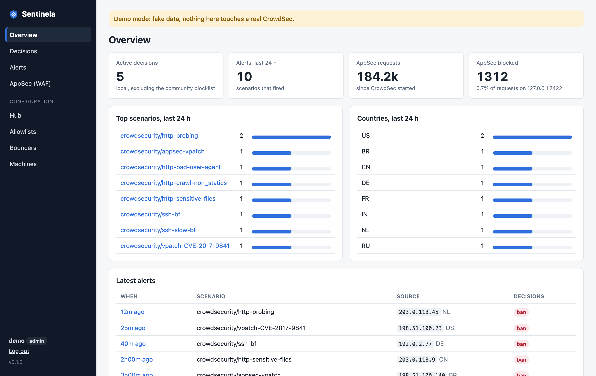
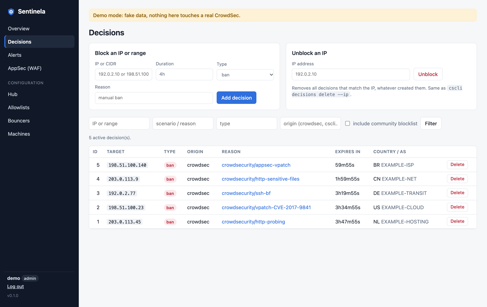
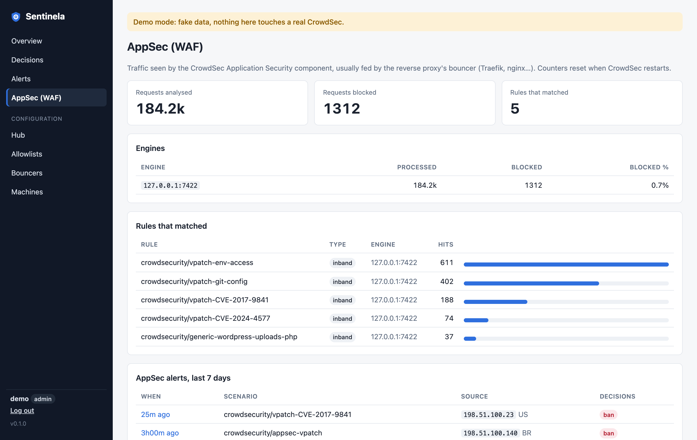
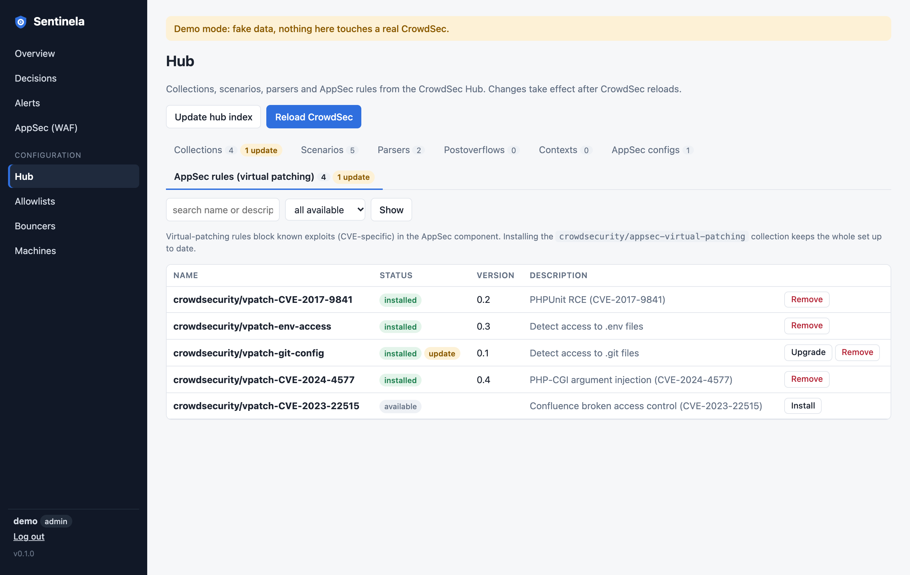
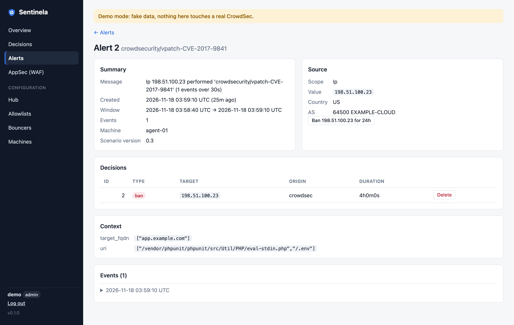
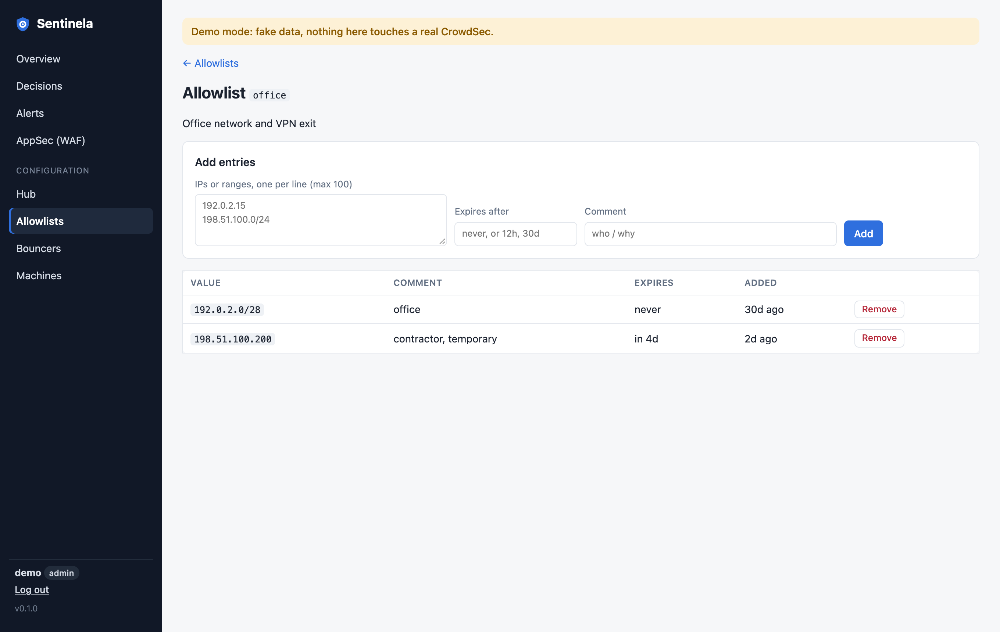
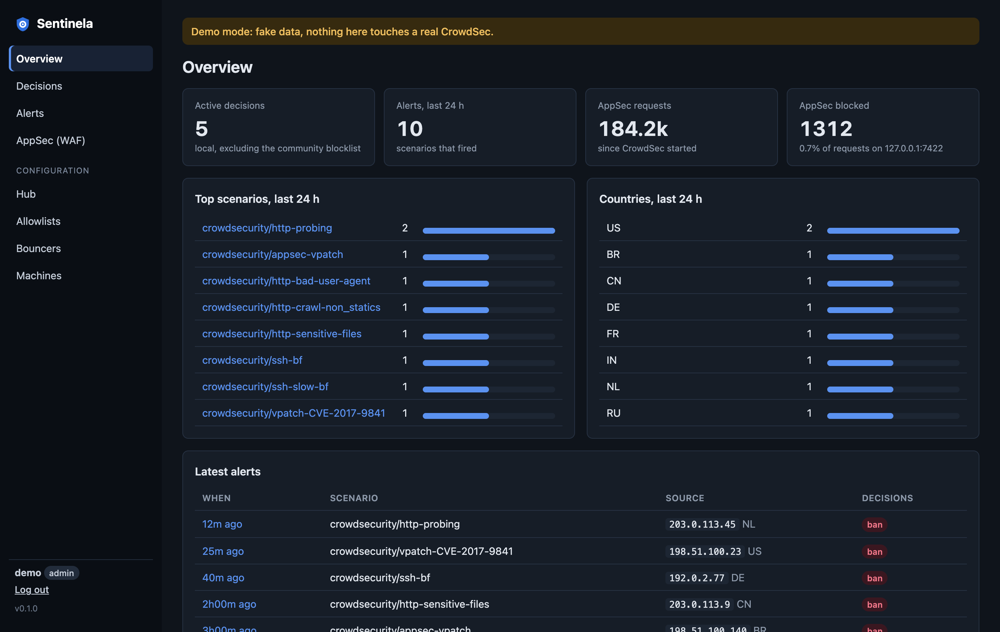

# Sentinela

A small, self-hosted web interface for [CrowdSec](https://crowdsec.net): decisions, alerts, the AppSec WAF, the hub, allowlists, bouncers and machines, without opening an SSH session to run `cscli`.



*[Versão em português mais abaixo.](#português)*

## Why this exists

CrowdSec works well, but almost everything you do with it day to day goes through `cscli` on the server. Someone calls because their office IP got banned: you connect to the VPN, SSH into the box, `sudo cscli decisions list -i …`, `sudo cscli decisions delete …`. You want to know whether the WAF is blocking anything: `sudo cscli metrics show appsec`. You want to add a virtual-patching rule: `sudo cscli appsec-rules install …`, then remember to reload.

The CrowdSec Console covers some of this, but it is a hosted service and some features are paid. I wanted something that runs next to CrowdSec, talks only to the local API, and lets me do the routine work from a browser:

- see and remove active decisions, ban or unban an IP or a range;
- read alerts, with the events and context behind them;
- see what the AppSec component analysed and blocked, and which rules fired;
- browse and install collections, scenarios, parsers and AppSec (virtual patching) rules;
- manage allowlists;
- check that bouncers are still pulling and machines are still alive.

It is one Go binary with server-rendered pages, no JavaScript framework and no database of its own.

| | |
|---|---|
|  |  |
|  |  |
|  |  |

## How it talks to CrowdSec

Sentinela uses three sources. You can enable any of them; pages whose source is missing say so instead of breaking.

| Source | Used for | What it needs |
|---|---|---|
| **Local API (LAPI)** | decisions (list, add, delete), alerts | a *machine* login (`cscli machines add`) |
| **Prometheus endpoint** (`:6060/metrics`) | AppSec counters, rule hits, decisions per origin | network access to the endpoint, no credentials |
| **cscli** | hub, allowlists, bouncers, machines, reload | running `cscli` locally (via `sudo`) or inside the CrowdSec container (via the Docker API) |

The LAPI only accepts what CrowdSec itself defines: manual decisions are added exactly like `cscli decisions add` does (an alert carrying a decision, origin `cscli`), and deletions use the same endpoints as `cscli decisions delete`.

`cscli` commands are run from a fixed list, as an argument vector (never through a shell), and every value that reaches them (IPs, names, durations, comments) is validated first.

## Quick look, without CrowdSec

```bash
go run ./cmd/sentinela demo
```

This starts a server on `127.0.0.1:8080` with fake data and prints a one-off password for the user `demo`. Nothing is sent anywhere.

## Installation

### Docker Compose

The image is `ghcr.io/noz-af-angola/sentinela`. It is built on distroless, runs as a non-root user, and has no shell.

[`examples/docker-compose.yml`](examples/docker-compose.yml) shows a full setup: CrowdSec, a Docker socket proxy and Sentinela behind Traefik. The steps:

1. Create a CrowdSec machine for Sentinela and keep its password in a file:

   ```bash
   mkdir -p secrets
   openssl rand -hex 24 > secrets/lapi_password
   docker exec crowdsec cscli machines add sentinela \
     --password "$(cat secrets/lapi_password)" -f /dev/null
   ```

2. Create the users file (see [Users and passwords](#users-and-passwords)):

   ```bash
   read -rs PW && printf '%s' "$PW" | docker run --rm -i ghcr.io/noz-af-angola/sentinela:0.1 hash-password
   # then write secrets/users.txt:  alice:admin:<hash>
   ```

3. Adjust the host name and the allowed source ranges in the Traefik labels, then `docker compose up -d`.

### On the host, with systemd

If CrowdSec is installed from packages, run Sentinela on the same machine and let it call `cscli` through a narrow `sudo` rule:

```bash
sudo useradd --system --no-create-home --shell /usr/sbin/nologin sentinela
sudo install -m 0755 sentinela /usr/local/bin/sentinela
sudo install -d -m 0750 -g sentinela /etc/sentinela
sudo install -m 0640 -g sentinela examples/systemd/sentinela.env /etc/sentinela/sentinela.env
sudo visudo -cf examples/sudoers/sentinela && sudo install -m 0440 examples/sudoers/sentinela /etc/sudoers.d/sentinela
sudo install -m 0644 examples/systemd/sentinela.service /etc/systemd/system/
sudo systemctl daemon-reload && sudo systemctl enable --now sentinela
```

Binaries are built with `go build ./cmd/sentinela` (Go 1.26 or newer).

### Building the image yourself

```bash
docker build --build-arg VERSION=$(git describe --tags --always) -t sentinela .
```

## Configuration

Everything is set through environment variables. Each secret can also be read from a file with the `_FILE` suffix, which is the better choice with Docker secrets.

| Variable | Default | Meaning |
|---|---|---|
| `SENTINELA_LISTEN` | `127.0.0.1:8080` (`:8080` in the image) | address to listen on |
| `SENTINELA_AUTH_MODE` | `local` | `local` (users file) or `proxy` (trust an SSO proxy) |
| `SENTINELA_USERS_FILE` | | path of the users file, required in `local` mode |
| `SENTINELA_TRUSTED_PROXIES` | | comma-separated networks whose `X-Forwarded-For` and SSO headers are believed; required in `proxy` mode |
| `SENTINELA_PROXY_USER_HEADER` | `Remote-User` | user header set by the proxy |
| `SENTINELA_PROXY_GROUPS_HEADER` | `Remote-Groups` | groups header set by the proxy |
| `SENTINELA_PROXY_ADMIN_GROUP` | | if set, only members of this group can make changes; everyone else is read-only |
| `SENTINELA_PROXY_LOGOUT_URL` | | where "Log out" sends you in `proxy` mode |
| `SENTINELA_LAPI_URL` | | e.g. `http://crowdsec:8080` |
| `SENTINELA_LAPI_MACHINE_ID` | | machine name created with `cscli machines add` |
| `SENTINELA_LAPI_PASSWORD` / `_FILE` | | its password |
| `SENTINELA_LAPI_CA_FILE` | | CA bundle if the LAPI uses TLS with a private CA |
| `SENTINELA_METRICS_URL` | | e.g. `http://crowdsec:6060/metrics` |
| `SENTINELA_CSCLI_MODE` | `none` | `none`, `exec` (local command) or `docker` (Docker Engine API) |
| `SENTINELA_CSCLI_COMMAND` | `cscli` | command to run; in `exec` mode typically `sudo -n /usr/bin/cscli` |
| `SENTINELA_RELOAD_COMMAND` | | `exec` mode only, e.g. `sudo -n /usr/bin/systemctl reload crowdsec` (in `docker` mode the container gets `SIGHUP`) |
| `SENTINELA_DOCKER_HOST` | `unix:///var/run/docker.sock` | Docker API, preferably a socket proxy such as `tcp://socket-proxy:2375` |
| `SENTINELA_DOCKER_CONTAINER` | `crowdsec` | name of the CrowdSec container |
| `SENTINELA_READ_ONLY` | `false` | nobody can change anything, whatever their role |
| `SENTINELA_COOKIE_SECURE` | `true` | set to `false` only when Sentinela is reached over plain HTTP, such as inside a VPN |
| `SENTINELA_SESSION_TTL` | `8h` | session lifetime |

Sentinela refuses to start with a configuration that would be unsafe, for example proxy mode without trusted proxies, or a trusted range of `0.0.0.0/0`.

## Users and passwords

In `local` mode the users file has one line per user:

```
name:role:bcrypt-hash[:totp-secret]
```

- `role` is `admin` (can change things) or `viewer` (read-only).
- Hashes come from `sentinela hash-password`, which reads the password on stdin. Passwords must be at least 12 characters.
- For two-factor login, run `sentinela totp-secret alice`, add the secret to the line, and scan the printed `otpauth://` URI (or type the secret) in any authenticator app.

Failed logins are throttled per client IP and per user name, and a TOTP code cannot be used twice.

### Behind Authelia or oauth2-proxy

With `SENTINELA_AUTH_MODE=proxy`, Sentinela does not show a login page. It reads the user from a header set by your SSO proxy, but only on connections that come from `SENTINELA_TRUSTED_PROXIES`. See [`examples/traefik/authelia-labels.yml`](examples/traefik/authelia-labels.yml).

## Security and threat model

Sentinela is an admin tool for a security component. Whoever can use it can unban attackers, allowlist ranges and remove detection rules. Treat it like SSH access to the server.

**What it protects against**

- *Anonymous access.* Every page except `/login`, `/healthz` and static files requires a session. There is no way to run it without authentication.
- *Password guessing.* bcrypt (cost 12), optional TOTP, throttling per IP and per user, the same error for every failure, and equal timing for unknown users.
- *Cross-site request forgery.* All changes are `POST` with a per-session token, checked in constant time, plus Go's cross-origin protection (`Sec-Fetch-Site`/`Origin`) and `SameSite=Strict` cookies.
- *XSS and clickjacking.* Pages are rendered with `html/template` (contextual escaping), under a strict Content-Security-Policy with no inline script, and `frame-ancestors 'none'`. Alert data comes from attackers' requests, so this matters.
- *Command injection.* No shell is ever involved. `cscli` arguments are validated (IPs and ranges are parsed and re-printed, names match strict patterns, free text is passed as `--flag=value` so it cannot become an option).
- *Spoofed identity headers.* In proxy mode, headers are only read from trusted peers, and `0.0.0.0/0` is rejected.
- *Accountability.* Every change is logged as a JSON line with user, client IP, action and target.

**What it does not protect against, and what you should do**

- *Exposure.* Do not publish Sentinela or the CrowdSec LAPI on the internet. Reach Sentinela through a VPN, an IP allowlist on the proxy, SSO, or several of these. The LAPI should only listen on localhost or an internal Docker network.
- *A compromised admin account* can do anything `cscli` can. Use TOTP or SSO with 2FA, and give `viewer` to people who only need to look.
- *The host or the cscli channel.* In `exec` mode the `sentinela` user may run `cscli` as root; in `docker` mode Sentinela can exec into the CrowdSec container, and the socket proxy must allow `POST` on containers, which is a lot of power on that host. Keep the socket proxy on an internal network that only Sentinela joins, or prefer the host install. If you only need decisions, alerts and metrics, leave `SENTINELA_CSCLI_MODE=none`.
- *Sessions are in memory.* Restarting logs everyone out. There is no account lockout persisted across restarts.
- *Plain HTTP.* If you set `SENTINELA_COOKIE_SECURE=false`, the session cookie travels unencrypted; only do it inside an encrypted tunnel.

Reporting vulnerabilities: see [SECURITY.md](SECURITY.md).

## Limits and known gaps

- Parser *whitelists* (YAML files in `parsers/s02-enrich/`) are listed but not edited. Allowlists, which CrowdSec now recommends, are fully managed.
- AppSec counters come from Prometheus and reset when CrowdSec restarts. For history, scrape the same endpoint with Prometheus/Grafana.
- `cscli` output changes a little between CrowdSec releases. Sentinela was written against the 1.6 series and reads fields under their known names; if something shows up empty, please open an issue with the JSON output of the command.

## Development

```bash
go test -race ./...
go vet ./...
golangci-lint run
go run ./cmd/sentinela demo
```

See [CONTRIBUTING.md](CONTRIBUTING.md). Changes are listed in [CHANGELOG.md](CHANGELOG.md).

## License

MIT, see [LICENSE](LICENSE). Sentinela is not affiliated with CrowdSec SAS; "CrowdSec" is their trademark.

---

## Português

Sentinela é uma interface web pequena, para instalar no próprio servidor, que faz pelo browser o trabalho do dia a dia com o CrowdSec, sem abrir uma sessão SSH para correr `cscli`.

### O problema

Quase tudo no CrowdSec passa pelo `cscli`. Um cliente liga a dizer que o IP do escritório foi bloqueado: liga-se a VPN, entra-se por SSH, `sudo cscli decisions list`, `sudo cscli decisions delete`. Para saber se o WAF está a bloquear alguma coisa, `sudo cscli metrics show appsec`. Para instalar uma regra de virtual patching, `sudo cscli appsec-rules install …` e depois não esquecer o reload.

Com a Sentinela pode:

- ver e apagar decisões, bloquear ou desbloquear um IP ou uma gama;
- ler os alertas, com os eventos e o contexto;
- ver o que o AppSec analisou e bloqueou e que regras dispararam;
- instalar e remover colecções, cenários, parsers e regras AppSec (virtual patching);
- gerir allowlists;
- confirmar que os bouncers e as máquinas continuam activos.

### Como funciona

Usa três fontes, todas opcionais: a API local (LAPI) com uma conta de máquina, para decisões e alertas; o endpoint Prometheus (`:6060/metrics`), para as métricas do AppSec; e o `cscli`, corrido localmente com `sudo` ou dentro do contentor do CrowdSec pela API do Docker, para o hub, as allowlists, os bouncers e as máquinas. Os comandos são sempre executados sem shell e todos os valores são validados antes.

### Instalação rápida

- **Docker Compose:** veja [`examples/docker-compose.yml`](examples/docker-compose.yml). Crie a máquina com `cscli machines add sentinela --password … -f /dev/null`, o ficheiro de utilizadores com `sentinela hash-password`, e ajuste as labels do Traefik.
- **No host com systemd:** use [`examples/systemd`](examples/systemd) e a regra de sudo em [`examples/sudoers`](examples/sudoers).
- **Experimentar sem CrowdSec:** `go run ./cmd/sentinela demo`.

### Segurança

A autenticação é obrigatória: utilizador e palavra-passe (bcrypt), com TOTP opcional, ou modo proxy atrás do Authelia ou do oauth2-proxy. Há papéis `admin` e `viewer`, protecção CSRF, CSP estrita e registo de todas as alterações. Mesmo assim, quem usa a Sentinela pode desbloquear atacantes e remover regras, por isso:

- não exponha a Sentinela nem a LAPI na internet: use VPN, lista de IPs no proxy ou SSO;
- active o TOTP ou o 2FA do SSO;
- se só precisa de decisões, alertas e métricas, deixe `SENTINELA_CSCLI_MODE=none`.

O modelo de ameaças completo está na secção [Security and threat model](#security-and-threat-model), em inglês.

### Licença

MIT. Autor: Gelson Fernandes.
